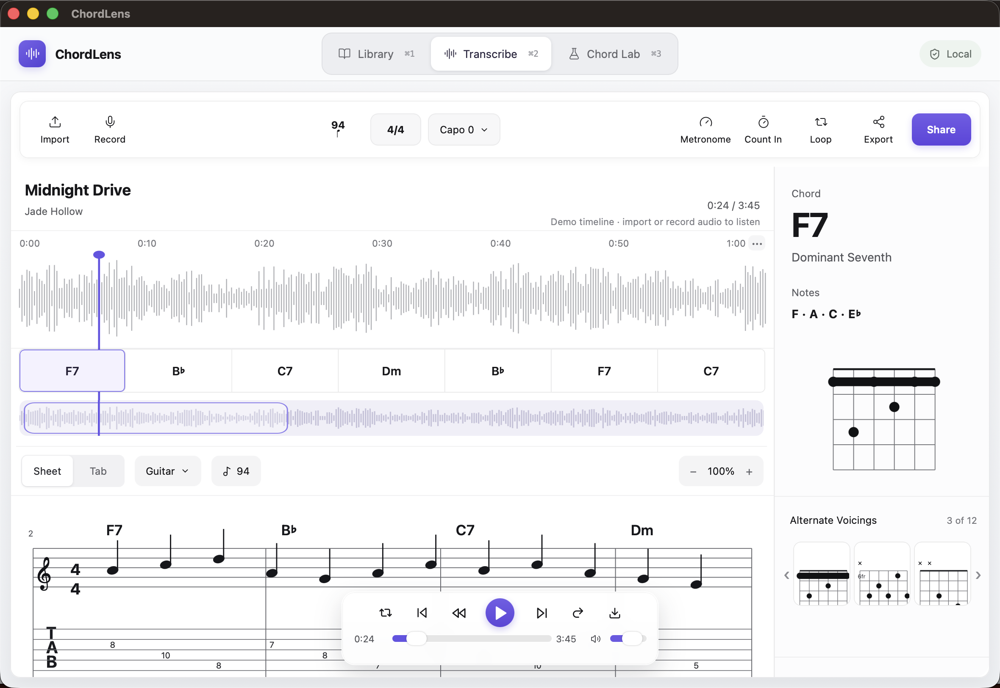

# ChordLens

ChordLens is a local-first macOS music transcription and chord-analysis utility. Library, Transcribe, and Chord Lab live in one native, freely movable and resizable macOS window; switch with the top workspace control or `⌘1`–`⌘3`.



## Install

Download the packaged macOS app from GitHub Releases, move it to `Applications`, and run it independently of the source checkout. The repository is only needed for development.

## Development

```bash
pnpm install
pnpm dev
pnpm test
pnpm test:visual
pnpm tauri dev
```

Open `http://127.0.0.1:1420/?view=design-preview` for the fixed 1448×1086 visual-regression composition.

## Audio analysis

The app ships with a browser-native local analysis fallback and a stable `TranscriptionEngine` interface. `engine/basic-pitch/transcribe.py` is the optional offline Basic Pitch adapter used when the Python dependency is installed.

Audio imports are checked locally and limited to 100 MB and one hour. The optional sidecar has bounded output and a three-minute deadline; recordings stop automatically after 15 minutes or whenever the Transcribe workspace closes.

## Release

The ready-to-run macOS bundle is available at `release/ChordLens.app`. The completed Codex Security report and remediation record are under `security-audit/2026-08-11/`.
